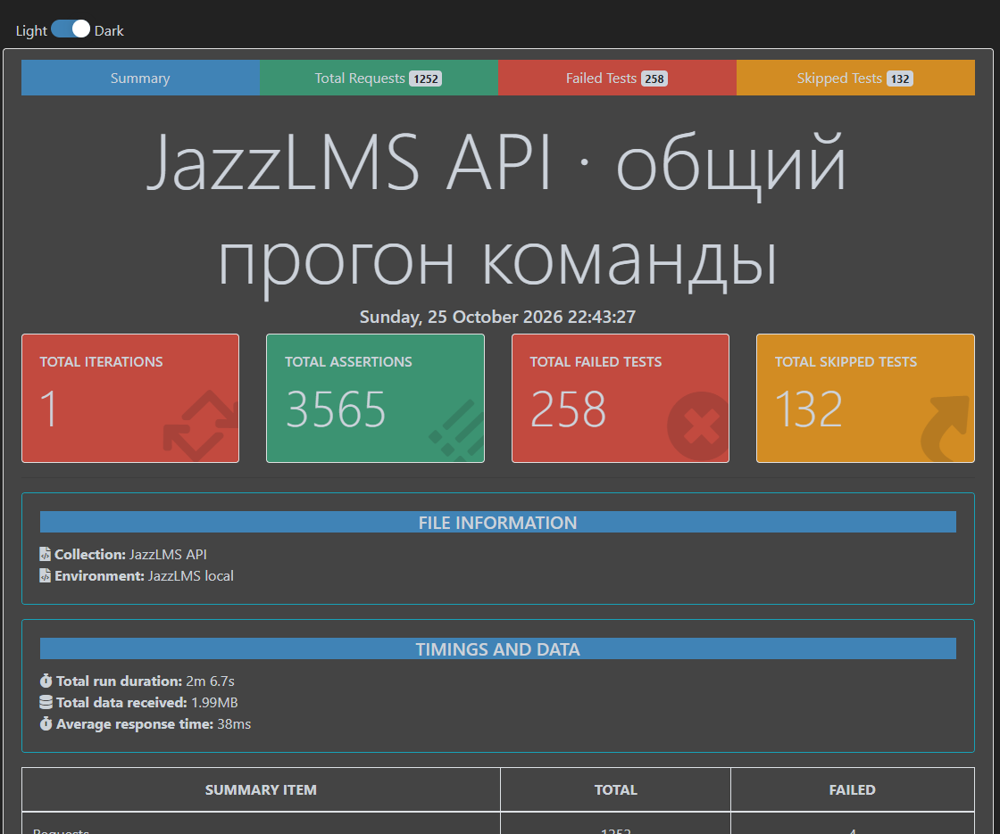

# Общий прогон коллекции JazzLMS API (§8.3)

Собирает и прогоняет Kantemir. Коллекция: `docs/postman/JazzLMS.postman_collection.json`,
окружение: `docs/postman/JazzLMS-local.postman_environment.json`.

## Как собрать и запустить

```bash
node docs/postman/merge.js
```

```bash
newman run docs/postman/JazzLMS.postman_collection.json -e docs/postman/JazzLMS-local.postman_environment.json --reporters cli,htmlextra --reporter-htmlextra-export docs/postman/reports/newman-report.html
```

`merge.js` берёт каркас Astra (`team/astra.postman_collection.json`) и вставляет в него только папки каждого студента
из его экспорта в `team/`. Копии чужого Setup и Auth в этих файлах не используются.
Подпапки в общих папках стоят перед запросами: так порядок одинаковый и в Postman Runner, и в Newman.

## Откуда взяты части (25.10.2026, вечер)

| Студент | PR | Что вошло |
|---|---|---|
| Astra | nuta312/jazzlms#13 | 00 Setup, 01 / Auth, Demo, 07 / E2E-1, 99 Teardown (TD-01, TD-02) |
| Tamara | nuta312/jazzlms#14 | 01 / Users |
| Alina | nuta312/jazzlms#15 | 01 / Branches, Groups; 07 / E2E-3; 99 / Alina |
| Nazgul | nazgulzh/jazzlms → nuta312/jazzlms#26 | 02 / Units, файлы, Certificates; 07 / E2E-5; 99 / Nazgyl |
| Ainura | nuta312/jazzlms#7 | 02 / Tests; 07 / E2E-6; 99 / Ainura |
| Kantemir | ветка tests/kantemir-postman | 03–06; 07 / E2E-7; 99 / Kantemir; запросы SETUP-K в 00 Setup |
| Zhyldyz | ZhyldyzQA-88/jazzlms, ветка postman/zhyldyz-course-service (PR ещё нет) | 02 / Courses, Categories, Enrollments; 07 / E2E-4; 99 / Zhyldyz |

## Результат

Чистый стенд, `strictGatewayErrors = false`. Три прогона подряд дали одинаковый результат, без единого отличия:
**920 запросов в коллекции (1252 вызова вместе с запросами из скриптов), 3697 проверок, 245 красных, 132 пропущено.**

| Часть | Красных проверок | Красных запросов | Совпадает с прогоном своего файла |
|---|---|---|---|
| Astra | 0 | 0 | да |
| Alina | 0 | 0 | да |
| Kantemir | 39 | 21 | да (отдельно — тоже 39) |
| Ainura | 48 | 23 | да |
| Tamara | 43 | 20 | да |
| Nazgul | 48 + 3 ошибки запроса | 16 | да |
| Zhyldyz | 77 — все её проверки | 39 | да |

У каждого красные в общей коллекции — ровно те же запросы, что и при прогоне его собственного файла:
сборка ничего не сломала, а красные — найденные дефекты (их Issues) или замечания ниже.
Пропущенные проверки — известные дефекты, которые авторы пометили сами (`strictGatewayErrors` и т. п.).

HTML-отчёт: `docs/postman/reports/newman-report.html`, его первая страница — .
htmlextra считает чуть иначе: 3565 проверок — без 132 пропущенных, а в «Failed Tests» (258) входят и ошибки запросов.

Сам отчёт (в git не кладётся — в нём токены тестовых пользователей;
прикладывается к PR файлом).

## Замечания по частям

- **Zhyldyz:** часть взята из её fork, PR пока нет. 36 запросов берут токен из переменной коллекции `json_web_token_1aig`, ещё 5 — из `json_web_token_1akb`; обе пустые и нигде не заполняются (вписывались руками в Postman). Поэтому 41 из 42 запросов получают 401 и проверки не доходят до сервиса — как и при прогоне её собственного файла. Нужно заменить их на `{{adminToken}}` / `{{instructorToken}}` из Setup (§1.5: «ничего не вписано руками»). Ещё: имена запросов не в формате §1.2 (`Get Categories` → `CAT-01 · GET /api/categories · … → 200`), файл лежит в корне репозитория, а не в `docs/postman/`. Её авторизация уровня коллекции перенесена на её папки как есть.
- **Tamara:** нет E2E-2 (§7). `USR-04 · … instructor смотрит ученика` падает с `getaddrinfo ENOTFOUND usr-04` —
  в URL запроса, похоже, попало его имя.
- **Nazgul:** загрузки уроков (UNT-02) ссылаются на файлы `video.mp4`, `doc.pdf`, `doc.docx`, `table.xlsx`, `slides.pptx`,
  которых нет в репозитории — в Newman и у других они не прикрепляются; отсюда 3 ошибки «request url is empty»
  в UNT-03 и UNT-05. Нужно положить файлы рядом с коллекцией (например, `docs/postman/nazgul/files/`) и указать относительный путь.
- **Astra и Nazgul:** оба PR добавляют `docs/postman/JazzLMS.postman_collection.json` — тот же файл, что собирает `merge.js`.
  Предложение: каждый держит свою коллекцию в своей папке, а общий файл собирает только `merge.js` (PR Kantemir — последним).
- Переменные коллекции из частей (`tstLib` у Ainura, `bearer_token_14lb` у Nazgul) переносятся в общую коллекцию.
- Имена переменных: мои `courseId` → `kCourseId` (его использует Nazgul) и `e2eCourseId` и др. → `e7…` (`e2eCourseId` использует Zhyldyz, её Teardown удалил бы мой курс).
