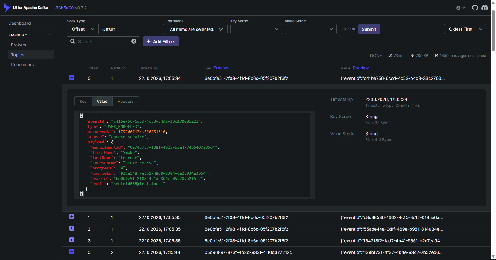
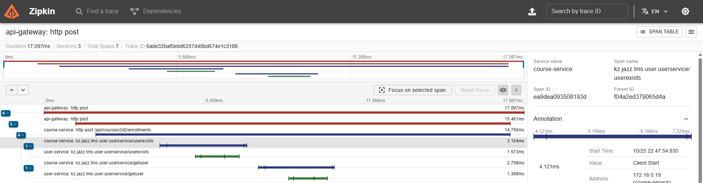

# API-тесты Kantemir: notification, analytics, gamification, безопасность, E2E-7

Здесь лежит часть коллекции Postman по `API_TEST_CHECKLIST.md` (§5, §6, E2E-7): 304 запроса и 1341 проверка. Общая коллекция всей команды — 920 запросов и 3697 проверок, итоги в [TEAM-RUN.md](../TEAM-RUN.md).

| Файл | Что это |
|---|---|
| `build.js` | Сборщик коллекции. Запросы и проверки описаны здесь, а JSON для Postman собирается из них |
| `JazzLMS-kantemir.postman_collection.json` | Готовая коллекция для импорта в Postman. Руками не правится, только через `build.js` |
| `../JazzLMS-local.postman_environment.json` | Окружение `JazzLMS local`: адреса gateway и сервисов. Токены пустые, их заполняет Setup |

## Общая коллекция команды

`docs/postman/merge.js` собирает одну коллекцию `docs/postman/JazzLMS.postman_collection.json`, как требует §8.1.
Основа — экспорт каркаса Astra из `docs/postman/team/astra.postman_collection.json`.
В него вставляются мои папки: 03–06 целиком, а в 00 Setup, 07 E2E и 99 Teardown — подпапки `Kantemir`.

```bash
node docs/postman/merge.js
```

```bash
newman run docs/postman/JazzLMS.postman_collection.json -e docs/postman/JazzLMS-local.postman_environment.json --reporters cli,htmlextra --reporter-htmlextra-export newman-report.html
```

В общей коллекции ученика создаёт Setup Astra: логин и пароль берутся из `learnerUsername` и `learnerPassword` в окружении.
Мои папки сами ничего не знают о том, чей это ученик: email и имя они берут из `GET /api/auth/me`.
Ученика в конце удаляет TD-01 Astra, а подпапка `99 Teardown / Kantemir` убирает только мои курсы, правила писем и настройки геймификации.

Когда сдаст кто-то ещё: экспорт его папки кладётся в `docs/postman/team/`, а в `PARTS` в `merge.js` дописывается одна строка.

## Как запустить отдельно

Стенд должен быть поднят с нуля:

```bash
docker compose --profile app down -v
docker compose --profile app up -d --build
```

Пересобрать коллекцию после правок в `build.js`:

```bash
node docs/postman/kantemir/build.js
```

Прогнать всё и получить HTML-отчёт:

```bash
newman run docs/postman/kantemir/JazzLMS-kantemir.postman_collection.json -e docs/postman/JazzLMS-local.postman_environment.json --reporters cli,htmlextra --reporter-htmlextra-export newman-report.html
```

В PowerShell список репортёров нужно взять в кавычки: `--reporters "cli,htmlextra"`.

В Postman: Import → оба файла, справа сверху выбрать окружение `JazzLMS local`, коллекция → Run.
Папку `00 Setup` нужно запускать первой. В отдельной коллекции её подпапка `Kantemir · логины` логинит роли
и создаёт своего ученика `learner_kantemir_<runId>` вместо Setup Astra.

## Как устроены проверки

- **Ожидаемый код записан в конце имени запроса**: `NTF-05 · POST /api/notifications · пустое name → 400`.
  Общие проверки стоят в начале вкладки Tests **каждого** запроса (§1.6). `build.js` вписывает их сам,
  поэтому в исходнике они написаны один раз. Они читают код из имени запроса и проверяют всё из §1.3:
  - для позитивных запросов — код, `Content-Type`, время ответа меньше 1500 мс, отсутствие `passwordHash`;
  - для негативных — `application/problem+json` с полями `title`, `status`, `detail` и отсутствие stack trace в `detail`.

  После общих проверок во вкладке Tests идут собственные проверки запроса.
- **Негативы §1.4 (N1–N8) для каждого эндпоинта** — запросы `NEG-NTF`, `NEG-ANL`, `NEG-GAM` в конце папок сервисов.
  Как разрешает §1.4, это не сотни запросов, а один запрос на каждый вид негатива для всего сервиса.
  Например, `NEG-NTF · N1 · без токена` вызывает сам первый путь, а остальные 10 путей сервиса отправляет из pre-request.
  На каждый путь во вкладке Tests заводится отдельная проверка, поэтому в отчёте видно, какой именно путь не прошёл.
  N1–N3 — без токена, мусорный токен и испорченная подпись → 401. N4 — роль ниже нужной → 403.
  N5 — несуществующий id → 404. N6 — `abc` вместо id → 400. N7 — чужой метод → 405. N8 — тело не JSON → 400.
  Отказы N1–N4 возвращает gateway, до сервиса они не доходят, поэтому даже запросы `DELETE` и `reset` здесь безопасны.
  У analytics нет запросов с телом, поэтому N8 для этого сервиса не применим.
- **Матрица ролей SEC-04** — как в таблице §6: разрешённый GET → ровно 200, разрешённый POST → ровно 201, запрещённый → 403.
  POST отправляются с настоящими телами; всё созданное (пользователь, ветка, шаблон, курсы) сразу удаляют запросы `SEC-cleanup`.
  Для самозаписи и попыток теста `SEC-prep` создаёт отдельный курс: с него снимается автозапись создателя, иначе admin получил бы 409.
- **Лимит запросов SEC-05** — ровно 60 запросов одним токеном. Сначала прогрев и пауза 2,5 с, чтобы лимит gateway был полным,
  потом 60 запросов разом с замером: проверяется, что все ответы пришли за 1 с и часть из них — 429.
- **Опрос вместо пауз.** Письма, лента событий и очки обновляются через Kafka с задержкой.
  Скрипт до запроса повторяет GET раз в 500 мс, пока результат не появится, но не дольше 10 с.
  Чтобы проверить, что что-то *не* произошло (GAM-02, GAM-12), сначала ждём, пока событие появится в аналитике.
  Это доказывает, что Kafka его доставила. После этого ждём ещё 1,5 с и смотрим, что очки не изменились.
- **Каждый прогон независим.** `runId` делает имена уникальными, каждая папка создаёт свои курсы.
  Папка `99 Teardown · Kantemir` всё удаляет и возвращает настройки геймификации к значениям по умолчанию.

## E2E-7: шаги, которые делаются руками

Сначала прогоните папки `00 Setup · Kantemir` и `07 E2E`, но не Teardown.
Нужный `learnerId` возьмите в Postman, в окружении.

**Redis и Mongo — данные действительно сохранились:**

```bash
docker exec jazzlms-redis-1 redis-cli ZSCORE leaderboard:points <learnerId>
```

```bash
docker exec jazzlms-mongo-1 mongosh gamification_db --quiet --eval "db.processed_events.countDocuments()"
```

Число из Redis должно совпасть с `points` в `GET /api/gamification/me`.

**Повторная доставка (идемпотентность):**

1. Откройте http://localhost:8090 → Topics → `enrollment-events` → Messages.
2. Найдите последнее сообщение с `"type":"COURSE_COMPLETED"`, скопируйте Key и Value.
3. Нажмите Produce Message и вставьте те же Key и Value.
4. В Postman повторите `E2E-7 · 10` и `E2E-7 · 09`: очки не изменились, второго письма нет.

**Сервис был выключен — событие не потерялось:**

```bash
docker compose stop gamification-service
```

Пока сервис выключен, пройдите учеником ещё один урок: создайте курс с двумя уроками или используйте `gamCourseId`.
Затем включите сервис обратно:

```bash
docker compose start gamification-service
```

В течение 30 с `GET /api/gamification/me` покажет начисленные очки: Kafka хранила событие, пока сервис был недоступен.

**Grafana:** http://localhost:3001 → Explore → источник Loki → запрос `{service="course-service"} |= "completed"`.
Из строки лога возьмите traceId (второе значение в квадратных скобках: `[course-service,<traceId>,…]`).
Поиск `{service=~".+"} |= "<traceId>"` покажет путь этого запроса через сервисы.

### Результат ручных шагов (22.10.2026, чистый стенд)

| Kafka UI: событие в `enrollment-events` | Zipkin: один запрос через 3 сервиса |
|---|---|
|  |  |

| Шаг | Результат |
|---|---|
| Redis / Mongo | `ZSCORE leaderboard:points` = 190, профиль в `gamification_db.profiles` = 190, ответ API = 190 — совпадает ✅ |
| Повторная доставка `COURSE_COMPLETED` | Очки 190 → 190 ✅ (в логе `already processed, skipping`), лента 1 → 1 ✅ (`Duplicate event … ignored`), **писем 1 → 2 ❌** — дефект ниже |
| gamification-service выключен | Ученик прошёл урок (200), в Kafka 1 непрочитанное событие; через 16 с после запуска очки 190 → 205 ✅. Пока сервис выключен, gateway отвечает на `/api/gamification/me` 500 — ожидалось бы 503 |
| Трассировка | Zipkin, один traceId: api-gateway → course-service `POST /enrollments` → user-service gRPC `userExists` и `getUser` ✅. В Loki этот traceId есть только в course-service: user-service не пишет в лог при gRPC-вызовах |

## Найденные дефекты

Готовые тексты для GitHub Issues — в [ISSUES.md](ISSUES.md): 14 дефектов отсюда и №7 — баг Astra в user-service
(табуляция в JSON → 500) с той же причиной, что у NTF-05.

Прогоны стабильны: в общей коллекции всей команды моя часть даёт 1341 проверку и 39 красных (все — мои найденные дефекты, 21 запрос) — ровно столько же, сколько при отдельном прогоне. Три общих прогона подряд — без отличий. Проверки формата ответов gateway пропускаются (`strictGatewayErrors = false`, договорённость команды, Issue #2); с `true` красных на 5 больше.
Каждая красная проверка — один из дефектов ниже: некоторые дефекты видны в нескольких запросах,
например NTF-11 и в NTF-11, и в NEG-NTF N5/N6.

Раньше, в версии без негативов N1–N8, был один случай из 11 прогонов, когда упала ещё одна проверка. Какая — не записалось.

| ID проверки | Что не так | Ожидалось | Фактически |
|---|---|---|---|
| NTF-05, NEG-NTF N8 | `eventType = XXX` или тело не JSON (POST и PUT) | 400 | 500 «Internal server error»: `HttpMessageNotReadableException` попадает в общий обработчик `Exception` |
| NTF-11, NEG-NTF N5/N6 | Удаление несуществующего письма `DELETE /messages/{id}` | 404 | 204: `deleteById` не проверяет, что запись есть |
| ANL-02 | `timeline?type=XXX` | 400 | 500: ошибка преобразования enum уходит в общий обработчик |
| ANL-05 | `timeline?page=-1` | 400 (§5.2) | 200, тихо подставляется страница 0. Это вопрос к требованиям |
| ANL-09 | `dashboard?period=year` | 400 | 200 с данными за сегодня, а в ответе `"period":"year"` — вводит в заблуждение |
| GAM-06, NEG-GAM N6 | `GET /users/abc` (невалидный UUID) | 400 | 500 |
| NEG-GAM N8 | `PUT /api/gamification/settings` с телом не JSON | 400 | 500 — та же причина, что у NTF-05, но в gamification-service |
| NEG-GAM N5 | Профиль несуществующего пользователя `GET /users/{id}` | 404 | 200 с пустым профилем (0 очков): нельзя отличить «нет такого пользователя» от «пользователь без очков» |
| NEG-ANL N6 | `GET /users/abc/activity`, `/courses/abc/activity` | 400 | 200 с нулями: id не проверяется на формат UUID |
| SEC-01 N2 | Прямой вызов сервиса с мусорным токеном `abc.def.ghi` | 401 с корректным problem+json | 401, но тело — невалидный JSON (перенос строки внутри `detail`), и в `detail` утекает внутреннее сообщение Jackson. Во всех 5 сервисах: `ServiceJwtFilter.reject` |
| SEC-07 (N1 §1.4) | Отказ gateway без токена | 401 + `WWW-Authenticate: Bearer` + problem+json | 401 и 403 от gateway — без тела и без заголовка (`JwtAuthFilter.reject`) |
| SEC-06 | `GET /api/nothing` без токена | 401 | 404: фильтр gateway срабатывает только для известных маршрутов. Вдобавок тело 404 не в формате problem+json |
| ANL-07 | `GET /api/analytics/summary` | Поля `logins, signups, completions, enrollments` (§5.2) | `logins, courseCompletions, usersWithActivity`: нет `signups` и `enrollments`, хотя analytics их считает (ключи `stats:signups:*`, `stats:enrollments:*` в Redis) |
| E2E-7 шаг 4 (вручную) | Повторная доставка того же `COURSE_COMPLETED` (тот же eventId) | Второго письма нет | **Второе письмо отправлено.** У `NotificationService.handle` нет проверки eventId, как у analytics (`existsByEventId`) и gamification (`processed_events`) |

### Зафиксировано по факту (вопрос к требованиям, тесты зелёные)

- NTF-04, NEG-NTF N6: невалидный ObjectId `abc` → 404, как и несуществующий.
- NTF-12: неизвестный плейсхолдер `{{foo}}` заменяется пустой строкой, письмо создаётся.
- ANL-04: `from > to` → 200 с пустой страницей.
- ANL-11, NEG-ANL N5: активность несуществующего пользователя или курса → 200 с нулями (чек-лист разрешает «200 или 404»).
- SEC-03: `bearer` строчными → 401.

### Не покрыто автотестами

- GAM-17 и E2E-7, шаги 4–6 — вручную, результаты выше.
- Redis `ZCARD leaderboard:points = 0` в GAM-16 проверяется косвенно: рейтинг `top = []`.
